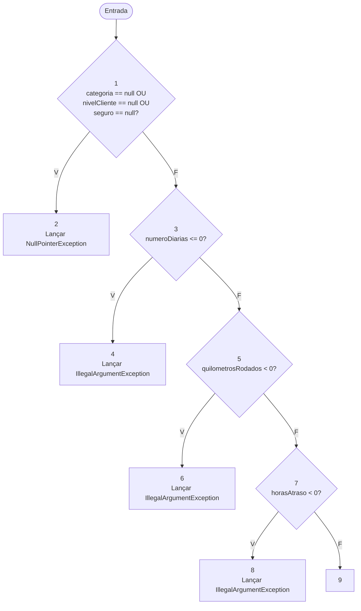
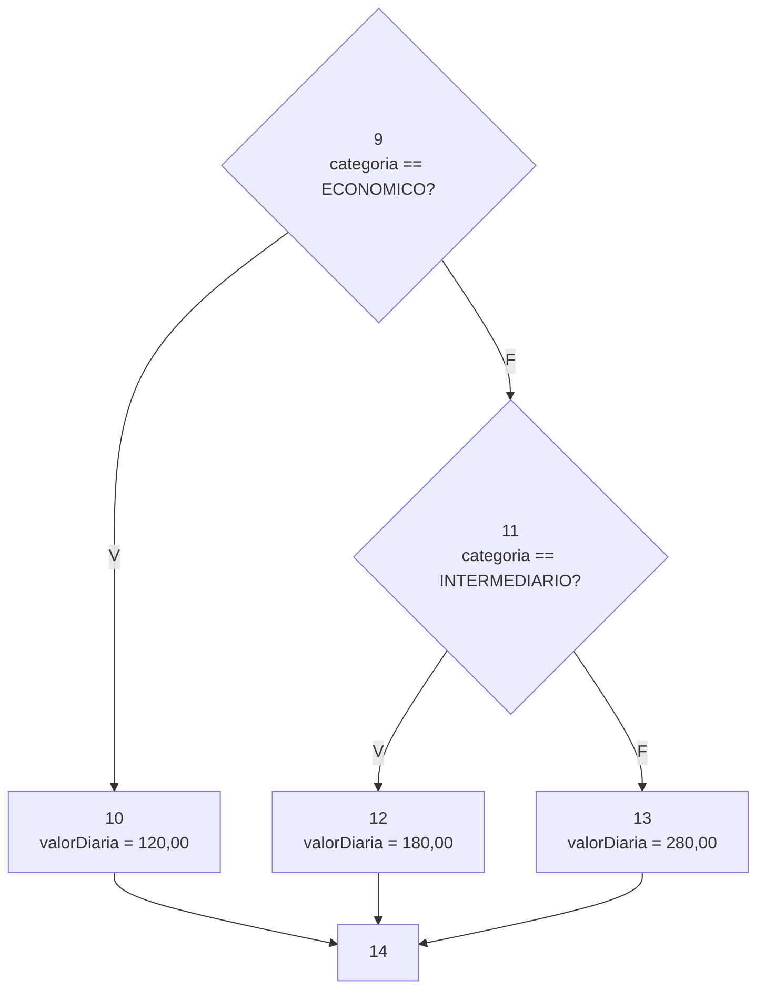
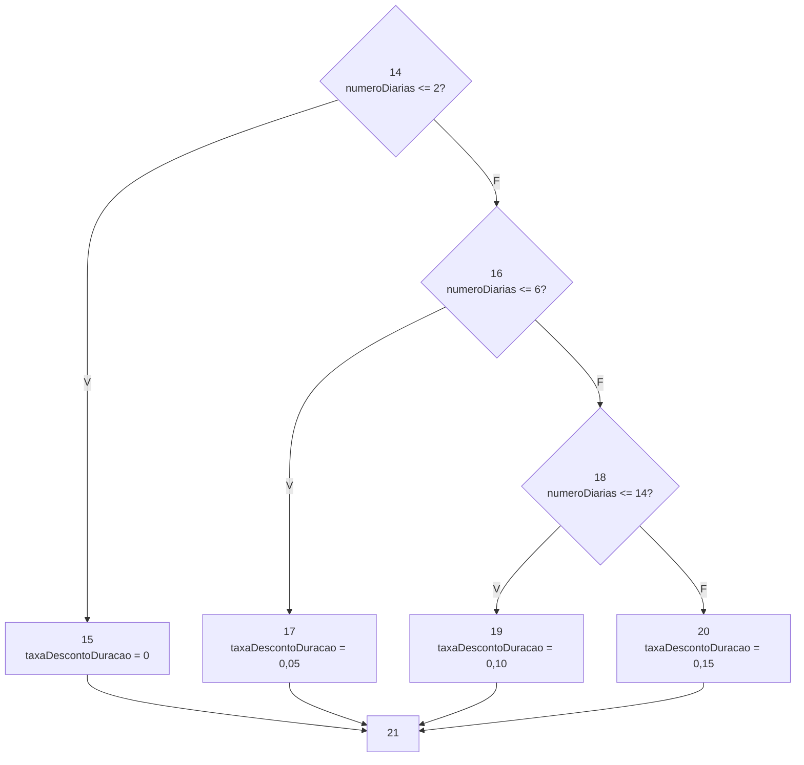
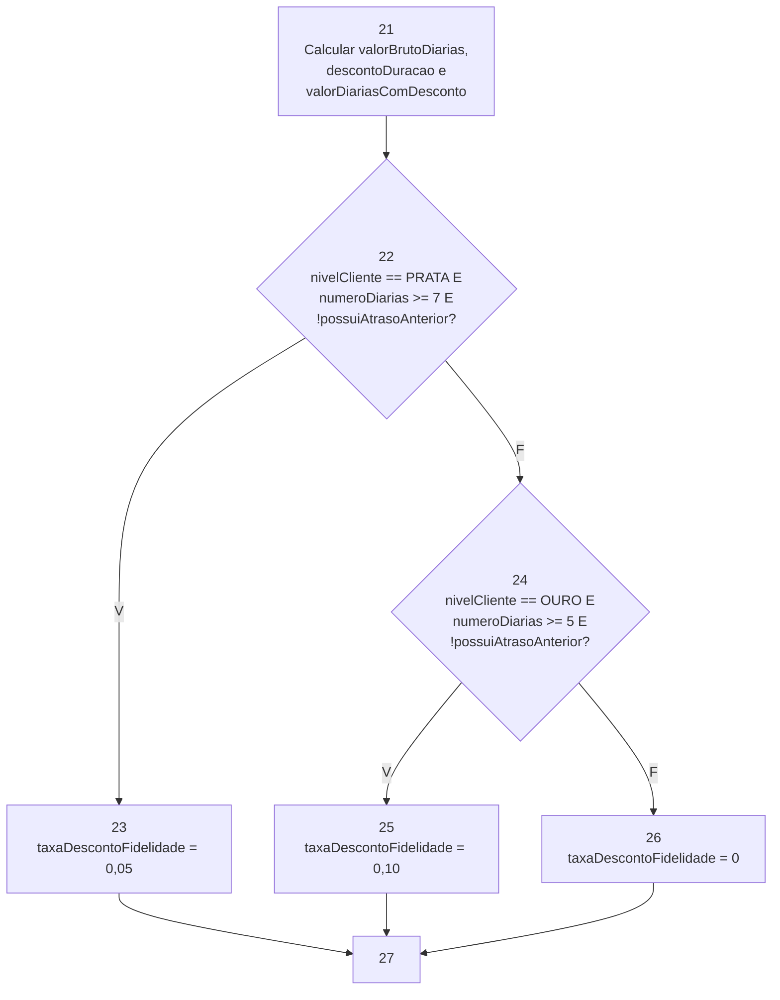
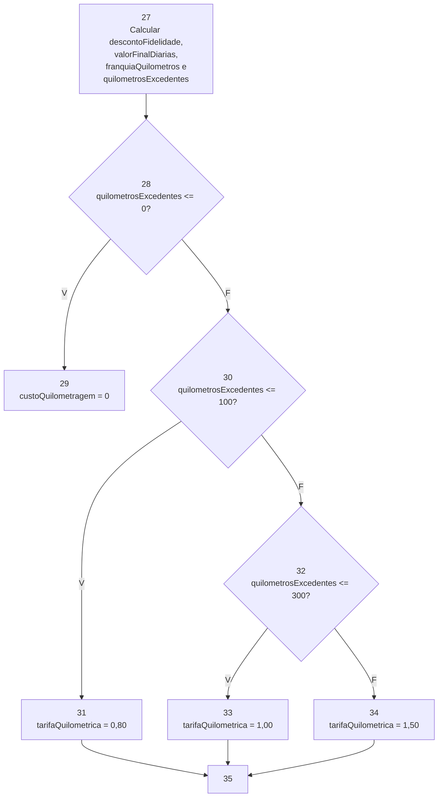
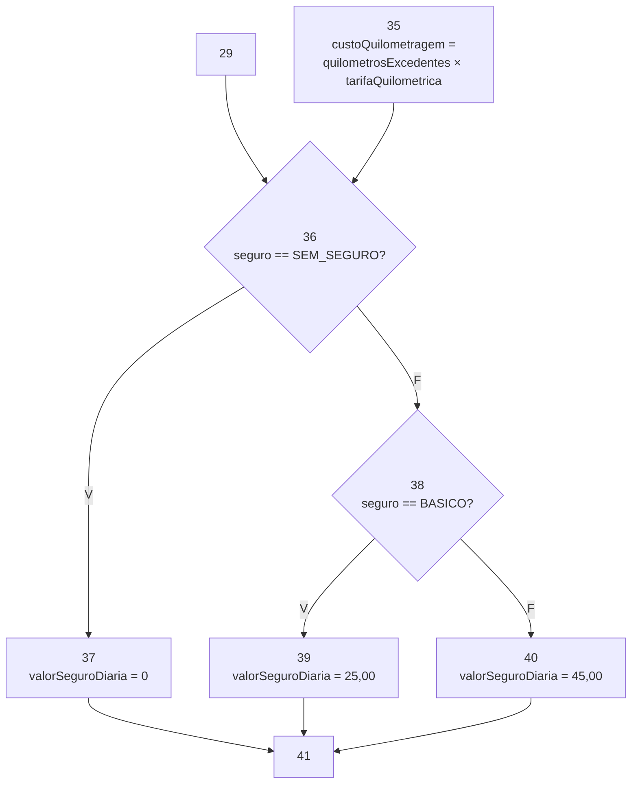

# Respostas — Trabalho Prático da Segunda Unidade

> Preencha os campos indicados e acrescente linhas às tabelas conforme necessário. Mantenha o código dos testes em `src/test/java` e os relatórios originais e logs em `evidencias/`, referenciados por links relativos neste arquivo. Consulte os requisitos completos no [enunciado](ENUNCIADO.md).

## Identificação dos alunos

| Integrante | Nome completo | Matrícula |
|---|---|---|
| Aluno(a) 1 | A preencher | A preencher |
| Aluno(a) 2 (se houver) | A preencher | A preencher |

- Turma: A preencher.
- Data: A preencher.
- `artifactId`: A preencher.

## 5.1. Cobertura de arestas

Classe: `CoberturaArestasTest.java`. Registre os resultados de sua execução isolada.

### Grafo de fluxo de controle

<!-- Insira o grafo e descreva as convenções de entrada, saída, curto-circuito e saídas por exceção. -->

Validação dos argumentos:

\
Valor da diária:

\
Desconto por duração:

\
Desconto por fidelidade:

\
Custo da quilometragem:

\
Custo do seguro:

\
Custo do atraso:

### Identificação dos nós e das arestas

| Nó | Trecho ou linhas do código | Descrição |
|---|---|---|
| A preencher | A preencher | A preencher |

| Aresta | Origem | Destino | Condição ou fluxo |
|---|---|---|---|
| A preencher | A preencher | A preencher | A preencher |

### Casos de teste e rastreabilidade

<!-- Informe todos os argumentos do método em cada caso. Para testes parametrizados, identifique também a invocação correspondente. Explique a obtenção do resultado esperado a partir das regras de negócio. -->

| Caso | Entradas | Resultado ou exceção esperados | Justificativa do resultado esperado | Arestas percorridas | Teste JUnit / invocação |
|---|---|---|---|---|---|
| A preencher | A preencher | A preencher | A preencher | A preencher | A preencher |

### Resultado da cobertura

| Medida | Resultado |
|---|---|
| Total de arestas do grafo | A preencher |
| Arestas percorridas | A preencher |
| Cobertura de arestas (%) | A preencher |
| Ramos cobertos do método no JaCoCo | A preencher |
| Ramos não cobertos do método no JaCoCo | A preencher |
| Cobertura de ramos (%) | A preencher |

Análise da correspondência entre grafo, testes e JaCoCo, incluindo exceções: A preencher.

Evidências HTML, XML e log (links relativos): A preencher.

## 5.2. Critério de McCabe

Classe: `CaminhosBasicosTest.java`. Registre os resultados de sua execução isolada.

### Complexidade ciclomática

| Elemento | Contagem |
|---|---|
| Nós (N) | A preencher |
| Arestas (E) | A preencher |
| Decisões binárias | A preencher |

- Cálculo por `E - N + 2`: A preencher.
- Cálculo por decisões binárias + 1: A preencher.
- Convenção de saída única e tratamento do curto-circuito: A preencher.
- Comparação com a complexidade do método no JaCoCo e explicação de divergências: A preencher.

### Caminhos independentes e testes

| Caminho | Sequência de nós ou arestas | Caso / entradas | Resultado esperado | Teste JUnit / invocação |
|---|---|---|---|---|
| A preencher | A preencher | A preencher | A preencher | A preencher |

### Demonstração de independência

<!-- Inclua a matriz caminho × aresta e sua análise ou a demonstração incremental exigida pelo enunciado. -->

A preencher.

### Caminhos inviáveis e limitações

<!-- Quando houver, apresente as restrições contraditórias, as alternativas buscadas e a justificativa para o tamanho do conjunto viável obtido. Caso não haja, registre isso após a análise. -->

A preencher.

## 5.3. MC/DC em duas decisões

Classe: `McdcTest.java`. Registre os resultados de sua execução isolada.

### Decisão 1

- Expressão e localização no código: A preencher.
- Condição A: A preencher.
- Condição B: A preencher.
- Condição C: A preencher.

| Caso / entradas | A (valor lógico) | B (valor lógico) | C (valor lógico) | Condições efetivamente avaliadas | Resultado da decisão | Resultado esperado do método | Teste JUnit / invocação |
|---|---|---|---|---|---|---|---|
| A preencher | A preencher | A preencher | A preencher | A preencher | A preencher | A preencher | A preencher |

| Condição | Par de casos | Demonstração da influência independente |
|---|---|---|
| A | A preencher | A preencher |
| B | A preencher | A preencher |
| C | A preencher | A preencher |

Justificativa de alcance da decisão, curto-circuito e atendimento ao MC/DC de causa única: A preencher.

### Decisão 2

- Expressão e localização no código: A preencher.
- Condição A: A preencher.
- Condição B: A preencher.
- Condição C: A preencher.

| Caso / entradas | A (valor lógico) | B (valor lógico) | C (valor lógico) | Condições efetivamente avaliadas | Resultado da decisão | Resultado esperado do método | Teste JUnit / invocação |
|---|---|---|---|---|---|---|---|
| A preencher | A preencher | A preencher | A preencher | A preencher | A preencher | A preencher | A preencher |

| Condição | Par de casos | Demonstração da influência independente |
|---|---|---|
| A | A preencher | A preencher |
| B | A preencher | A preencher |
| C | A preencher | A preencher |

Justificativa de alcance da decisão, curto-circuito e atendimento ao MC/DC de causa única: A preencher.

## 5.4. Teste de mutação com PIT

Escopo: suíte completa das três classes de teste.

### Configuração e resultados

- Escopo e operadores utilizados: A preencher.
- Comando executado e resultado da execução Maven: A preencher.
- Total de mutantes: A preencher.
- Percentual de mutantes com status `KILLED`: A preencher.

| Status no PIT | Quantidade |
|---|---|
| A preencher | A preencher |

Testes acrescentados ou aprimorados após a análise: A preencher.

Evidências HTML, XML e log (links relativos): A preencher.

### Análise individual de mutantes não mortos

<!-- Repita os campos abaixo para cada mutante não morto. Se todos foram mortos, registre esse resultado e a evidência correspondente. -->

- Identificação, linha e operador: A preencher.
- Alteração realizada pelo mutante: A preencher.
- Status no PIT: A preencher.
- Tentativas de teste e resultados: A preencher.
- Justificativa técnica da impossibilidade, quando aplicável: A preencher.
- Demonstração de equivalência para todo o domínio previsto, quando alegada: A preencher.
- Eventual flexibilização do bloqueio Maven e justificativa: A preencher.

## 5.5. Test smells com tsDetect

Escopo: suíte completa das três classes de teste.

### Configuração e abrangência

- Versão/commit e adaptações utilizadas: A preencher.
- Comando executado, requisitos e limiares: A preencher.
- Quantidade e identificação dos arquivos e métodos esperados: A preencher.
- Quantidade e identificação dos arquivos e métodos analisados: A preencher.
- Conferência de reconhecimento dos recursos JUnit utilizados: A preencher.

### Ocorrências e refatorações

<!-- Registre todos os tipos de smell analisados, inclusive aqueles com zero ocorrências. -->

| Tipo de smell | Ocorrências iniciais | Refatoração realizada, se necessária | Ocorrências finais |
|---|---|---|---|
| A preencher | A preencher | A preencher | A preencher |

Verificação de preservação das asserções, cobertura, caminhos de McCabe, MC/DC e resultado de mutação após as refatorações: A preencher.

Evidências do relatório original, resumo de abrangência e logs (links relativos): A preencher.

## 5.6. Automação e relatório consolidado

### Ambiente e versões

| Componente | Versão utilizada |
|---|---|
| Java | A preencher |
| Maven | A preencher |
| JUnit | A preencher |
| JaCoCo | A preencher |
| PIT e plugin JUnit 5 | A preencher |
| tsDetect e adaptação | A preencher |
| Python e Git | A preencher |

### Execuções finais

<!-- Registre os comandos efetivamente executados na versão final da entrega. -->

| Análise | Comando e perfil | Data da execução | Resultado Maven | Relatório / log (link relativo) |
|---|---|---|---|---|
| JUnit | A preencher | A preencher | A preencher | A preencher |
| JaCoCo / arestas isoladas | A preencher | A preencher | A preencher | A preencher |
| JaCoCo / caminhos isolados | A preencher | A preencher | A preencher | A preencher |
| JaCoCo / MC/DC isolado | A preencher | A preencher | A preencher | A preencher |
| PIT | A preencher | A preencher | A preencher | A preencher |
| tsDetect | A preencher | A preencher | A preencher | A preencher |

- Testes executados: A preencher.
- Falhas: A preencher.
- Erros: A preencher.
- Testes ignorados: A preencher.
- Alterações na automação ou opções de execução, se houver: A preencher.
- Identificação da versão final analisada (commit, se disponível): A preencher.

### Conclusão por requisito

| Requisito | Resultado alcançado | Evidência / seção | Limitações ou justificativas |
|---|---|---|---|
| 100% de cobertura de arestas | A preencher | A preencher | A preencher |
| Caminhos básicos de McCabe | A preencher | A preencher | A preencher |
| MC/DC nas duas decisões | A preencher | A preencher | A preencher |
| Todos os mutantes mortos ou impossibilidades justificadas | A preencher | A preencher | A preencher |
| Zero ocorrências no tsDetect | A preencher | A preencher | A preencher |
| Execução reproduzível pelo Maven | A preencher | A preencher | A preencher |

## 6. Conferência da entrega

- [ ] Integrantes e `artifactId` identificados.
- [ ] Todas as respostas preenchidas neste arquivo.
- [ ] Código de produção fornecido preservado.
- [ ] Código dos testes nas três classes exigidas em `src/test/java`, com cada critério demonstrado isoladamente.
- [ ] Instruções do README conferidas e atualizadas, se necessário.
- [ ] Relatórios e logs da versão final copiados para `evidencias/` e referenciados neste arquivo.
- [ ] Recursos necessários à abertura dos relatórios HTML preservados.
- [ ] Projeto compactado no formato e com o nome exigidos, sem `target`.
