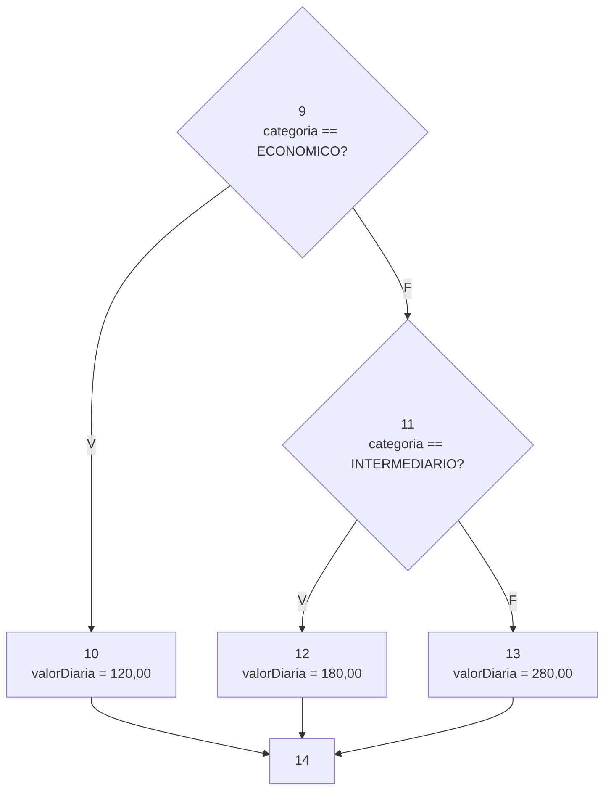
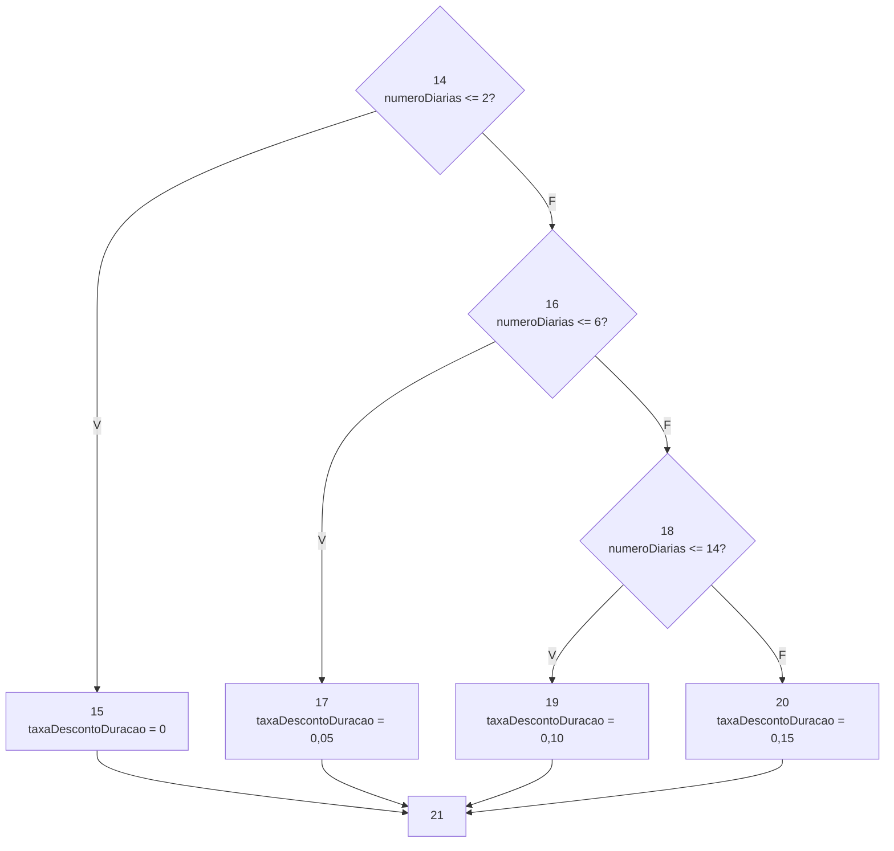
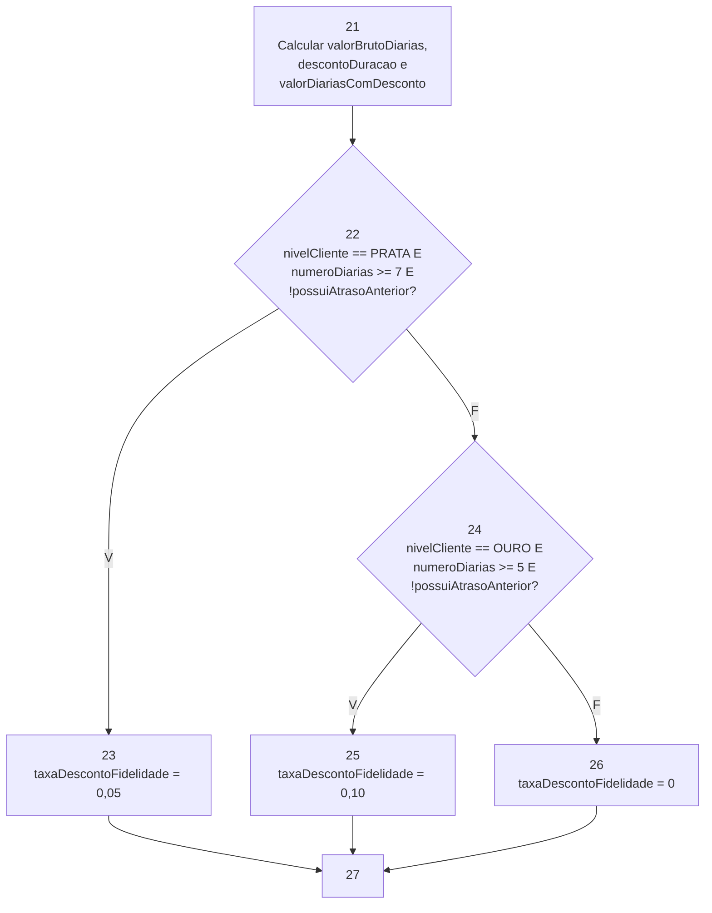
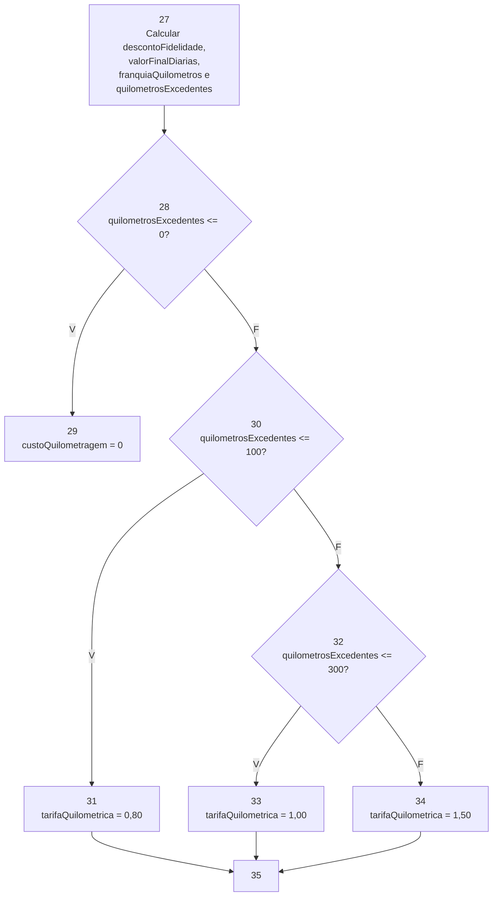
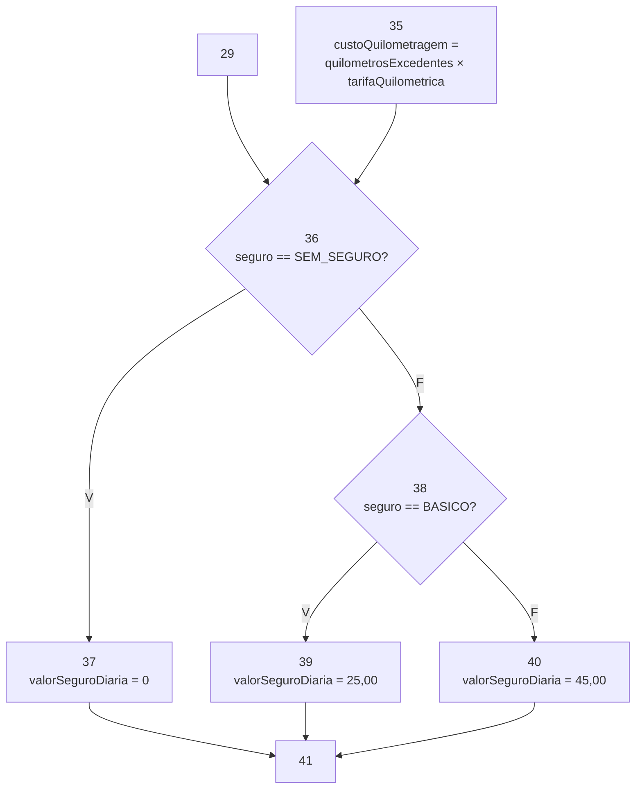

# Respostas — Trabalho Prático da Segunda Unidade

> Preencha os campos indicados e acrescente linhas às tabelas conforme necessário. Mantenha o código dos testes em `src/test/java` e os relatórios originais e logs em `evidencias/`, referenciados por links relativos neste arquivo. Consulte os requisitos completos no [enunciado](ENUNCIADO.md).

## Identificação dos alunos

| Integrante | Nome completo | Matrícula |
|---|---|---|
| Aluno(a) 1 | A preencher | A preencher |
| Aluno(a) 2 (se houver) | A preencher | A preencher |

- Turma: A preencher.
- Data: A preencher.
- `artifactId`: A preencher.

## 5.1. Cobertura de arestas

Classe: `CoberturaArestasTest.java`. Registre os resultados de sua execução isolada.

### Grafo de fluxo de controle

<!-- Insira o grafo e descreva as convenções de entrada, saída, curto-circuito e saídas por exceção. -->

Validação dos argumentos:

\
Valor da diária:

\
Desconto por duração:

\
Desconto por fidelidade:

\
Custo da quilometragem:

\
Custo do seguro:

\
Custo do atraso:

### Identificação dos nós e das arestas

| Nó | Trecho ou linhas do código | Descrição |
|---|---|---|
| IN | Linha 8 | Entrada do método `calcularCustoLocacao` |
| N1 | Linha 10 | Verificação conjunta: `categoria == null OU nivelCliente == null OU seguro == null` |
| N2 | Linhas 12–13 | Lançamento de `NullPointerException` |
| N3 | Linha 15 | Verificação: `numeroDiarias <= 0` |
| N4 | Linhas 17–18 | Lançamento de `IllegalArgumentException` para número de diárias |
| N5 | Linha 20 | Verificação: `quilometrosRodados < 0` |
| N6 | Linhas 22–23 | Lançamento de `IllegalArgumentException` para quilometragem |
| N7 | Linha 25 | Verificação: `horasAtraso < 0` |
| N8 | Linhas 27–28 | Lançamento de `IllegalArgumentException` para horas de atraso |
| N9 | Linha 31 | Verificação: `categoria == ECONOMICO` |
| N10 | Linha 33 | Define `valorDiaria = 120,00` |
| N11 | Linha 35 | Verificação: `categoria == INTERMEDIARIO` |
| N12 | Linha 37 | Define `valorDiaria = 180,00` |
| N13 | Linhas 39–41 | Bloco `else`; define `valorDiaria = 280,00` para SUV |
| N14 | Linha 45 | Verificação: `numeroDiarias <= 2` |
| N15 | Linhas 47–48 | Define desconto por duração igual a `0%` |
| N16 | Linha 49 | Verificação: `numeroDiarias <= 6` |
| N17 | Linhas 51–52 | Define desconto por duração igual a `5%` |
| N18 | Linha 53 | Verificação: `numeroDiarias <= 14` |
| N19 | Linhas 55–56 | Define desconto por duração igual a `10%` |
| N20 | Linhas 57–60 | Bloco `else`; define desconto por duração igual a `15%` |
| N21 | Linhas 62–64 | Calcula `valorBrutoDiarias`, `descontoDuracao` e `valorDiariasComDesconto` |
| N22 | Linhas 66 e 68 | Verificação conjunta: `nivelCliente == PRATA E numeroDiarias >= 7 E !possuiAtrasoAnterior` |
| N23 | Linhas 70–71 | Define desconto de fidelidade igual a `5%` |
| N24 | Linha 72 | Verificação conjunta: `nivelCliente == OURO E numeroDiarias >= 5 E !possuiAtrasoAnterior` |
| N25 | Linhas 74–75 | Define desconto de fidelidade igual a `10%` |
| N26 | Linhas 76–79 | Bloco `else`; define desconto de fidelidade igual a `0%` |
| N27 | Linhas 81–86 | Calcula `descontoFidelidade`, `valorFinalDiarias`, `franquiaQuilometros` e `quilometrosExcedentes` |
| N28 | Linha 88 | Verificação: `quilometrosExcedentes <= 0` |
| N29 | Linhas 90–91 | Define `custoQuilometragem = 0` |
| N30 | Linha 95 | Verificação: `quilometrosExcedentes <= 100` |
| N31 | Linhas 97–98 | Define `tarifaQuilometrica = 0,80` |
| N32 | Linha 99 | Verificação: `quilometrosExcedentes <= 300` |
| N33 | Linhas 101–102 | Define `tarifaQuilometrica = 1,00` |
| N34 | Linhas 103–106 | Bloco `else`; define `tarifaQuilometrica = 1,50` |
| N35 | Linha 107 | Calcula `custoQuilometragem` |
| N36 | Linha 111 | Verificação: `seguro == SEM_SEGURO` |
| N37 | Linhas 113–114 | Define `valorSeguroDiaria = 0` |
| N38 | Linha 115 | Verificação: `seguro == BASICO` |
| N39 | Linhas 117–118 | Define `valorSeguroDiaria = 25,00` |
| N40 | Linhas 119–122 | Bloco `else`; define `valorSeguroDiaria = 45,00` para seguro completo |
| N41 | Linha 123 | Calcula `custoSeguro` |
| N42 | Linha 126 | Verificação: `horasAtraso <= 1` |
| N43 | Linhas 128–129 | Define `custoAtraso = 0` |
| N44 | Linha 131 | Verificação: `horasAtraso <= 3` |
| N45 | Linhas 132–133 | Calcula `custoAtraso` proporcional |
| N46 | Linhas 135–137 | Bloco `else`; define `custoAtraso = valorDiaria` |
| N47 | Linhas 139–140 | Calcula o total, arredonda e retorna `total.setScale(2, RoundingMode.HALF_UP)` |
| OUT | — | Saída do grafo |

| Aresta | Origem | Destino | Condição ou fluxo |
|---|---|---|---|
| A1 | IN | N1 | Entrada do método |
| A2 | N1 | N2 | Validação nula verdadeira |
| A3 | N1 | N3 | Validação nula falsa |
| A4 | N3 | N4 | `numeroDiarias <= 0` verdadeiro |
| A5 | N3 | N5 | `numeroDiarias <= 0` falso |
| A6 | N5 | N6 | `quilometrosRodados < 0` verdadeiro |
| A7 | N5 | N7 | `quilometrosRodados < 0` falso |
| A8 | N7 | N8 | `horasAtraso < 0` verdadeiro |
| A9 | N7 | N9 | `horasAtraso < 0` falso |
| A10 | N9 | N10 | Categoria é `ECONOMICO` |
| A11 | N9 | N11 | Categoria não é `ECONOMICO` |
| A12 | N11 | N12 | Categoria é `INTERMEDIARIO` |
| A13 | N11 | N13 | Categoria não é `INTERMEDIARIO`; utiliza SUV |
| A14 | N10 | N14 | Continua após definir diária econômica |
| A15 | N12 | N14 | Continua após definir diária intermediária |
| A16 | N13 | N14 | Continua após definir diária SUV |
| A17 | N14 | N15 | `numeroDiarias <= 2` verdadeiro |
| A18 | N14 | N16 | `numeroDiarias <= 2` falso |
| A19 | N16 | N17 | `numeroDiarias <= 6` verdadeiro |
| A20 | N16 | N18 | `numeroDiarias <= 6` falso |
| A21 | N18 | N19 | `numeroDiarias <= 14` verdadeiro |
| A22 | N18 | N20 | `numeroDiarias <= 14` falso |
| A23 | N15 | N21 | Continua após desconto de duração de `0%` |
| A24 | N17 | N21 | Continua após desconto de duração de `5%` |
| A25 | N19 | N21 | Continua após desconto de duração de `10%` |
| A26 | N20 | N21 | Continua após desconto de duração de `15%` |
| A27 | N21 | N22 | Entra na decisão de fidelidade |
| A28 | N22 | N23 | Decisão de fidelidade PRATA verdadeira |
| A29 | N22 | N24 | Decisão de fidelidade PRATA falsa |
| A30 | N24 | N25 | Decisão de fidelidade OURO verdadeira |
| A31 | N24 | N26 | Decisão de fidelidade OURO falsa |
| A32 | N23 | N27 | Continua após desconto de fidelidade PRATA |
| A33 | N25 | N27 | Continua após desconto de fidelidade OURO |
| A34 | N26 | N27 | Continua sem desconto de fidelidade |
| A35 | N27 | N28 | Entra na decisão de quilometragem |
| A36 | N28 | N29 | `quilometrosExcedentes <= 0` verdadeiro |
| A37 | N28 | N30 | `quilometrosExcedentes <= 0` falso |
| A38 | N30 | N31 | `quilometrosExcedentes <= 100` verdadeiro |
| A39 | N30 | N32 | `quilometrosExcedentes <= 100` falso |
| A40 | N32 | N33 | `quilometrosExcedentes <= 300` verdadeiro |
| A41 | N32 | N34 | `quilometrosExcedentes <= 300` falso |
| A42 | N29 | N36 | Continua sem custo de quilometragem |
| A43 | N31 | N35 | Utiliza tarifa de `0,80` |
| A44 | N33 | N35 | Utiliza tarifa de `1,00` |
| A45 | N34 | N35 | Utiliza tarifa de `1,50` |
| A46 | N35 | N36 | Após calcular o custo da quilometragem |
| A47 | N36 | N37 | Seguro é `SEM_SEGURO` |
| A48 | N36 | N38 | Seguro diferente de `SEM_SEGURO` |
| A49 | N38 | N39 | Seguro é `BASICO` |
| A50 | N38 | N40 | Seguro diferente de `BASICO`; utiliza seguro completo |
| A51 | N37 | N41 | Continua após seguro sem cobrança |
| A52 | N39 | N41 | Continua após seguro básico |
| A53 | N40 | N41 | Continua após seguro completo |
| A54 | N41 | N42 | Entra na decisão de atraso |
| A55 | N42 | N43 | `horasAtraso <= 1` verdadeiro |
| A56 | N42 | N44 | `horasAtraso <= 1` falso |
| A57 | N44 | N45 | `horasAtraso <= 3` verdadeiro |
| A58 | N44 | N46 | `horasAtraso <= 3` falso |
| A59 | N43 | N47 | Continua após atraso sem cobrança |
| A60 | N45 | N47 | Continua após atraso proporcional |
| A61 | N46 | N47 | Continua após cobrança de uma diária |
| A62 | N47 | OUT | Saída normal |

### Casos de teste e rastreabilidade

<!-- Informe todos os argumentos do método em cada caso. Para testes parametrizados, identifique também a invocação correspondente. Explique a obtenção do resultado esperado a partir das regras de negócio. -->

| Caso | Entradas | Resultado ou exceção esperados | Justificativa do resultado esperado | Arestas percorridas | Teste JUnit / invocação |
|---|---|---|---|---|---|
| B1 | `ECONOMICO, COMUM, 1, 0, 0, SEM_SEGURO, false` | `R$ 120,00` | Uma diária sem descontos ou cobranças adicionais | `A1, A3, A5, A7, A9, A10, A14, A17, A23, A27, A29, A31, A34, A35, A37, A42, A47, A51, A54, A55, A59, A62` | `deveCalcularLocacaoBasica[1]` |
| B2 | `ECONOMICO, COMUM, 2, 0, 0, SEM_SEGURO, false` | `R$ 240,00` | Duas diárias sem descontos ou cobranças adicionais | `A1, A3, A5, A7, A9, A10, A14, A17, A23, A27, A29, A31, A34, A35, A37, A42, A47, A51, A54, A55, A59, A62` | `deveCalcularLocacaoBasica[2]` |
| C1 | `INTERMEDIARIO, COMUM, 1, 0, 0, SEM_SEGURO, false` | `R$ 180,00` | Categoria intermediária com diária de R$ 180,00 | `A1, A3, A5, A7, A9, A11, A12, A15, A17, A23, A27, A29, A31, A34, A35, A37, A42, A47, A51, A54, A55, A59, A62` | `casosAdicionaisDeSucesso[C1]` |
| C2 | `SUV, COMUM, 1, 0, 0, SEM_SEGURO, false` | `R$ 280,00` | Categoria SUV com diária de R$ 280,00 | `A1, A3, A5, A7, A9, A11, A13, A16, A17, A23, A27, A29, A31, A34, A35, A37, A42, A47, A51, A54, A55, A59, A62` | `casosAdicionaisDeSucesso[C2]` |
| D1 | `ECONOMICO, COMUM, 3, 0, 0, SEM_SEGURO, false` | `R$ 342,00` | Três diárias com desconto de duração de 5% | `A1, A3, A5, A7, A9, A10, A14, A18, A19, A24, A27, A29, A31, A34, A35, A37, A42, A47, A51, A54, A55, A59, A62` | `casosAdicionaisDeSucesso[D1]` |
| D2 | `ECONOMICO, COMUM, 7, 0, 0, SEM_SEGURO, false` | `R$ 756,00` | Sete diárias com desconto de duração de 10% | `A1, A3, A5, A7, A9, A10, A14, A18, A20, A21, A25, A27, A29, A31, A34, A35, A37, A42, A47, A51, A54, A55, A59, A62` | `casosAdicionaisDeSucesso[D2]` |
| D3 | `ECONOMICO, COMUM, 15, 0, 0, SEM_SEGURO, false` | `R$ 1.530,00` | Quinze diárias com desconto de duração de 15% | `A1, A3, A5, A7, A9, A10, A14, A18, A20, A22, A26, A27, A29, A31, A34, A35, A37, A42, A47, A51, A54, A55, A59, A62` | `casosAdicionaisDeSucesso[D3]` |
| P1 | `ECONOMICO, PRATA, 7, 0, 0, SEM_SEGURO, false` | `R$ 718,20` | Cliente PRATA elegível ao desconto de fidelidade de 5% | `A1, A3, A5, A7, A9, A10, A14, A18, A20, A21, A25, A27, A28, A32, A35, A37, A42, A47, A51, A54, A55, A59, A62` | `casosAdicionaisDeSucesso[P1]` |
| P2 | `ECONOMICO, PRATA, 6, 0, 0, SEM_SEGURO, false` | `R$ 684,00` | Cliente PRATA com menos de 7 diárias | `A1, A3, A5, A7, A9, A10, A14, A18, A19, A24, A27, A29, A31, A34, A35, A37, A42, A47, A51, A54, A55, A59, A62` | `casosAdicionaisDeSucesso[P2]` |
| P3 | `ECONOMICO, PRATA, 7, 0, 0, SEM_SEGURO, true` | `R$ 756,00` | Atraso anterior impede o benefício | `A1, A3, A5, A7, A9, A10, A14, A18, A20, A21, A25, A27, A28, A32, A35, A37, A42, A47, A51, A54, A55, A59, A62` | `casosAdicionaisDeSucesso[P3]` |
| P4 | `ECONOMICO, COMUM, 7, 0, 0, SEM_SEGURO, false` | `R$ 756,00` | Cliente COMUM não recebe fidelidade | `A1, A3, A5, A7, A9, A10, A14, A18, A20, A21, A25, A27, A29, A31, A34, A35, A37, A42, A47, A51, A54, A55, A59, A62` | `casosAdicionaisDeSucesso[P4]` |
| O1 | `ECONOMICO, OURO, 5, 0, 0, SEM_SEGURO, false` | `R$ 513,00` | Cliente OURO elegível ao desconto de fidelidade de 10% | `A1, A3, A5, A7, A9, A10, A14, A18, A19, A24, A27, A29, A30, A33, A35, A37, A42, A47, A51, A54, A55, A59, A62` | `casosAdicionaisDeSucesso[O1]` |
| O2 | `ECONOMICO, OURO, 4, 0, 0, SEM_SEGURO, false` | `R$ 456,00` | Cliente OURO com menos de 5 diárias | `A1, A3, A5, A7, A9, A10, A14, A18, A19, A24, A27, A29, A30, A33, A35, A37, A42, A47, A51, A54, A55, A59, A62` | `casosAdicionaisDeSucesso[O2]` |
| O3 | `ECONOMICO, OURO, 5, 0, 0, SEM_SEGURO, true` | `R$ 570,00` | Atraso anterior impede o benefício | `A1, A3, A5, A7, A9, A10, A14, A18, A19, A24, A27, A29, A30, A33, A35, A37, A42, A47, A51, A54, A55, A59, A62` | `casosAdicionaisDeSucesso[O3]` |
| O4 | `ECONOMICO, COMUM, 5, 0, 0, SEM_SEGURO, false` | `R$ 570,00` | Cliente COMUM não recebe fidelidade | `A1, A3, A5, A7, A9, A10, A14, A18, A19, A24, A27, A29, A31, A34, A35, A37, A42, A47, A51, A54, A55, A59, A62` | `casosAdicionaisDeSucesso[O4]` |
| K1 | `ECONOMICO, COMUM, 1, 100, 0, SEM_SEGURO, false` | `R$ 120,00` | Quilometragem igual à franquia | `A1, A3, A5, A7, A9, A10, A14, A17, A23, A27, A29, A31, A34, A35, A36, A42, A47, A51, A54, A55, A59, A62` | `casosAdicionaisDeSucesso[K1]` |
| K2 | `ECONOMICO, COMUM, 1, 200, 0, SEM_SEGURO, false` | `R$ 200,00` | 100 km excedentes a R$ 0,80 por km | `A1, A3, A5, A7, A9, A10, A14, A17, A23, A27, A29, A31, A34, A35, A37, A38, A43, A46, A47, A51, A54, A55, A59, A62` | `casosAdicionaisDeSucesso[K2]` |
| K3 | `ECONOMICO, COMUM, 1, 400, 0, SEM_SEGURO, false` | `R$ 420,00` | 300 km excedentes a R$ 1,00 por km | `A1, A3, A5, A7, A9, A10, A14, A17, A23, A27, A29, A31, A34, A35, A37, A39, A40, A44, A46, A47, A51, A54, A55, A59, A62` | `casosAdicionaisDeSucesso[K3]` |
| K4 | `ECONOMICO, COMUM, 1, 500, 0, SEM_SEGURO, false` | `R$ 720,00` | 400 km excedentes a R$ 1,50 por km | `A1, A3, A5, A7, A9, A10, A14, A17, A23, A27, A29, A31, A34, A35, A37, A39, A41, A45, A46, A47, A51, A54, A55, A59, A62` | `casosAdicionaisDeSucesso[K4]` |
| S1 | `ECONOMICO, COMUM, 1, 0, 0, BASICO, false` | `R$ 145,00` | Diária mais seguro básico | `A1, A3, A5, A7, A9, A10, A14, A17, A23, A27, A29, A31, A34, A35, A37, A42, A48, A49, A52, A54, A55, A59, A62` | `casosAdicionaisDeSucesso[S1]` |
| S2 | `ECONOMICO, COMUM, 1, 0, 0, COMPLETO, false` | `R$ 165,00` | Diária mais seguro completo | `A1, A3, A5, A7, A9, A10, A14, A17, A23, A27, A29, A31, A34, A35, A37, A42, A48, A50, A53, A54, A55, A59, A62` | `casosAdicionaisDeSucesso[S2]` |
| A1 | `ECONOMICO, COMUM, 1, 0, 1, SEM_SEGURO, false` | `R$ 120,00` | Até 1 hora de atraso não gera cobrança | `A1, A3, A5, A7, A9, A10, A14, A17, A23, A27, A29, A31, A34, A35, A37, A42, A47, A51, A54, A55, A59, A62` | `casosAdicionaisDeSucesso[A1]` |
| A2 | `ECONOMICO, COMUM, 1, 0, 2, SEM_SEGURO, false` | `R$ 168,00` | Duas horas geram cobrança proporcional | `A1, A3, A5, A7, A9, A10, A14, A17, A23, A27, A29, A31, A34, A35, A37, A42, A47, A51, A54, A56, A57, A60, A62` | `casosAdicionaisDeSucesso[A2]` |
| A3 | `ECONOMICO, COMUM, 1, 0, 4, SEM_SEGURO, false` | `R$ 240,00` | Quatro horas geram cobrança de uma diária adicional | `A1, A3, A5, A7, A9, A10, A14, A17, A23, A27, A29, A31, A34, A35, A37, A42, A47, A51, A54, A56, A58, A61, A62` | `casosAdicionaisDeSucesso[A3]` |
| E1 | `null, COMUM, 1, 0, 0, SEM_SEGURO, false` | `NullPointerException` | Categoria nula | `A1, A2` | `deveLancarExcecaoQuandoCategoriaForNula` |
| E2 | `ECONOMICO, null, 1, 0, 0, SEM_SEGURO, false` | `NullPointerException` | Nível do cliente nulo | `A1, A2` | `deveLancarExcecaoQuandoNivelClienteForNulo` |
| E3 | `ECONOMICO, COMUM, 1, 0, 0, null, false` | `NullPointerException` | Seguro nulo | `A1, A2` | `deveLancarExcecaoQuandoSeguroForNulo` |
| E4 | `ECONOMICO, COMUM, 0, 0, 0, SEM_SEGURO, false` | `IllegalArgumentException` | Número de diárias inválido | `A1, A3, A4` | `deveLancarExcecaoQuandoNumeroDeDiariasForInvalido` |
| E5 | `ECONOMICO, COMUM, 1, -1, 0, SEM_SEGURO, false` | `IllegalArgumentException` | Quilometragem negativa | `A1, A3, A5, A6` | `deveLancarExcecaoQuandoQuilometragemForNegativa` |
| E6 | `ECONOMICO, COMUM, 1, 0, -1, SEM_SEGURO, false` | `IllegalArgumentException` | Horas de atraso negativas | `A1, A3, A5, A7, A8` | `deveLancarExcecaoQuandoHorasDeAtrasoForemNegativas` |
| E7 | `null, COMUM, 0, 0, 0, SEM_SEGURO, false` | `NullPointerException` | Exceção nula prevalece sobre diárias inválidas | `A1, A2` | `devePriorizarNuloQuandoTambemHouverDiariasInvalidas` |

### Resultado da cobertura

| Medida | Resultado |
|---|---|
| Total de arestas do grafo | 62 |
| Arestas percorridas | 62 |
| Cobertura de arestas (%) | 100% |
| Ramos cobertos do método no JaCoCo | 48 |
| Ramos não cobertos do método no JaCoCo | 0 |
| Cobertura de ramos (%) | 100% |

### Análise da correspondência entre grafo, testes e JaCoCo, incluindo exceções:
O GFC possui 47 nós numerados. A tabela de arestas possui 62
arestas.

Com base na rastreabilidade dos casos de teste, as 62 arestas identificadas
no GFC foram percorridas pelo conjunto de testes, resultando em:

Cobertura de arestas = 62 / 62 × 100 = 100%.

Na execução pelo JaCoCo, foram registrados 48 ramos cobertos
e nenhum ramo não coberto na classe analisada, correspondendo a 100% de
cobertura de ramos.

Evidências HTML, XML e log (links relativos): A preencher.

## 5.2. Critério de McCabe

Classe: `CaminhosBasicosTest.java`. Registre os resultados de sua execução isolada.

### Complexidade ciclomática

| Elemento | Contagem |
|---|---|
| Nós (N) | A preencher |
| Arestas (E) | A preencher |
| Decisões binárias | A preencher |

- Cálculo por `E - N + 2`: A preencher.
- Cálculo por decisões binárias + 1: A preencher.
- Convenção de saída única e tratamento do curto-circuito: A preencher.
- Comparação com a complexidade do método no JaCoCo e explicação de divergências: A preencher.

### Caminhos independentes e testes

| Caminho | Sequência de nós ou arestas | Caso / entradas | Resultado esperado | Teste JUnit / invocação |
|---|---|---|---|---|
| A preencher | A preencher | A preencher | A preencher | A preencher |

### Demonstração de independência

<!-- Inclua a matriz caminho × aresta e sua análise ou a demonstração incremental exigida pelo enunciado. -->

A preencher.

### Caminhos inviáveis e limitações

<!-- Quando houver, apresente as restrições contraditórias, as alternativas buscadas e a justificativa para o tamanho do conjunto viável obtido. Caso não haja, registre isso após a análise. -->

A preencher.

## 5.3. MC/DC em duas decisões

Classe: `McdcTest.java`. Registre os resultados de sua execução isolada.

### Decisão 1

- Expressão e localização no código: linha 68 de `CalculadoraCustoLocacao.java`.
- Condição A: nivelCliente == NivelCliente.PRATA.
- Condição B: numeroDiarias >= 7.
- Condição C: !possuiAtrasoAnterior.

| Caso / entradas | A (valor lógico) | B (valor lógico) | C (valor lógico) | Condições efetivamente avaliadas | Resultado da decisão | Resultado esperado do método | Teste JUnit / invocação |
|---|---|---|---|---|---|---|---|
| PRATA-BASE: ECONOMICO, PRATA, 7, 0, 0, SEM_SEGURO, false | V | V | V | A, B e C | V | 718,20 | deveAtenderMcdcDaDecisaoPrata |
| PRATA-A: ECONOMICO, COMUM, 7, 0, 0, SEM_SEGURO, false | F | V | V | A | F | 756,00 | deveAtenderMcdcDaDecisaoPrata |
| PRATA-B: ECONOMICO, PRATA, 6, 0, 0, SEM_SEGURO, false | V | F | V | A e B | F | 684,00 | deveAtenderMcdcDaDecisaoPrata |
| PRATA-C: ECONOMICO, PRATA, 7, 0, 0, SEM_SEGURO, true | V | V | F | A, B e C | F | 756,00 | deveAtenderMcdcDaDecisaoPrata |

| Condição | Par de casos | Demonstração da influência independente |
|---|---|---|
| A | PRATA-BASE × PRATA-A | B e C permanecem verdadeiras. A muda de V para F e a decisão muda de V para F. |
| B | PRATA-BASE × PRATA-B | A e C permanecem verdadeiras. B muda de V para F e a decisão muda de V para F. |
| C | PRATA-BASE × PRATA-C | A e B permanecem verdadeiras. C muda de V para F e a decisão muda de V para F. |

Justificativa de alcance da decisão, curto-circuito e atendimento ao MC/DC de causa única:

O caso PRATA-BASE é V porque o cliente é PRATA,
possui pelo menos sete diárias e não possui atraso anterior.
No caso PRATA-A, somente A assume valor F. Como o operador utilizado
é &&, a avaliação é interrompida após A e B e C não são
avaliadas durante a execução.\
No caso PRATA-B, A é V e B é F. Por isso, C não é avaliada devido ao curto-circuito.\
No caso PRATA-C, as três condições são avaliadas, mas C é F porque
existe atraso anterior.\
Os pares PRATA-BASE × PRATA-A, PRATA-BASE × PRATA-B e
PRATA-BASE × PRATA-C demonstram que cada condição pode alterar
independentemente o resultado da decisão.\
Portanto, a decisão PRATA atende
ao MC/DC de causa única.

### Decisão 2

- Expressão e localização no código: linha 72 de CalculadoraCustoLocacao.java.
- Condição A: nivelCliente == NivelCliente.OURO.
- Condição B: numeroDiarias >= 5.
- Condição C: !possuiAtrasoAnterior.

| Caso / entradas | A (valor lógico) | B (valor lógico) | C (valor lógico) | Condições efetivamente avaliadas | Resultado da decisão | Resultado esperado do método | Teste JUnit / invocação |
|---|---|---|---|---|---|---|---|
| OURO-BASE: ECONOMICO, OURO, 5, 0, 0, SEM_SEGURO, false |  V |  V |  V | A, B e C | V | R$ 513,00 | deveAtenderMcdcDaDecisaoOuro |
| OURO-A: ECONOMICO, COMUM, 5, 0, 0, SEM_SEGURO, false   |  F |  V |  V | A | F | R$ 570,00 | deveAtenderMcdcDaDecisaoOuro |
| OURO-B: ECONOMICO, OURO, 4, 0, 0, SEM_SEGURO, false    |  V |  F |  V | A e B | F | R$ 456,00 | deveAtenderMcdcDaDecisaoOuro |
| OURO-C: ECONOMICO, OURO, 5, 0, 0, SEM_SEGURO, true     |  V |  V |  F | A, B e C | F | R$ 570,00 | deveAtenderMcdcDaDecisaoOuro |

| Condição | Par de casos | Demonstração da influência independente |
|---|---|---|
| A | OURO-BASE × OURO-A | B e C permanecem verdadeiras. A muda de V para F e a decisão muda de V para F. |
| B | OURO-BASE × OURO-B | A e C permanecem verdadeiras. B muda de V para F e a decisão muda de V para F. |
| C | OURO-BASE × OURO-C | A e B permanecem verdadeiras. C muda de V para F e a decisão muda de V para F. |

Justificativa de alcance da decisão, curto-circuito e atendimento ao MC/DC de causa única:\
A decisão OURO é alcançada nos casos em que a decisão PRATA anterior é
F.\
No caso OURO-BASE, o cliente é OURO, possui pelo menos cinco
diárias e não possui atraso anterior. Portanto, as três condições são
verdadeiras e o desconto de 10% é aplicado.\
No caso OURO-A, A é F porque o cliente é COMUM. Assim, B e C não são
avaliadas pela expressão OURO.\
No caso OURO-B, A é verdadeira e B é falsa porque há somente quatro
diárias. Dessa forma, C não é avaliada.\
No caso OURO-C, A e B são verdadeiras, mas C é falsa devido à existência
de atraso anterior. As três condições são avaliadas.\
Os pares OURO-BASE × OURO-A, OURO-BASE × OURO-B e
OURO-BASE × OURO-C demonstram a influência independente de A, B e C.
Portanto, a decisão OURO atende ao MC/DC de causa única.

## 5.4. Teste de mutação com PIT

Escopo: suíte completa das três classes de teste.

### Configuração e resultados

- Escopo e operadores utilizados: A preencher.
- Comando executado e resultado da execução Maven: A preencher.
- Total de mutantes: A preencher.
- Percentual de mutantes com status `KILLED`: A preencher.

| Status no PIT | Quantidade |
|---|---|
| A preencher | A preencher |

Testes acrescentados ou aprimorados após a análise: A preencher.

Evidências HTML, XML e log (links relativos): A preencher.

### Análise individual de mutantes não mortos

<!-- Repita os campos abaixo para cada mutante não morto. Se todos foram mortos, registre esse resultado e a evidência correspondente. -->

- Identificação, linha e operador: A preencher.
- Alteração realizada pelo mutante: A preencher.
- Status no PIT: A preencher.
- Tentativas de teste e resultados: A preencher.
- Justificativa técnica da impossibilidade, quando aplicável: A preencher.
- Demonstração de equivalência para todo o domínio previsto, quando alegada: A preencher.
- Eventual flexibilização do bloqueio Maven e justificativa: A preencher.

## 5.5. Test smells com tsDetect

Escopo: suíte completa das três classes de teste.

### Configuração e abrangência

- Versão/commit e adaptações utilizadas: A preencher.
- Comando executado, requisitos e limiares: A preencher.
- Quantidade e identificação dos arquivos e métodos esperados: A preencher.
- Quantidade e identificação dos arquivos e métodos analisados: A preencher.
- Conferência de reconhecimento dos recursos JUnit utilizados: A preencher.

### Ocorrências e refatorações

<!-- Registre todos os tipos de smell analisados, inclusive aqueles com zero ocorrências. -->

| Tipo de smell | Ocorrências iniciais | Refatoração realizada, se necessária | Ocorrências finais |
|---|---|---|---|
| A preencher | A preencher | A preencher | A preencher |

Verificação de preservação das asserções, cobertura, caminhos de McCabe, MC/DC e resultado de mutação após as refatorações: A preencher.

Evidências do relatório original, resumo de abrangência e logs (links relativos): A preencher.

## 5.6. Automação e relatório consolidado

### Ambiente e versões

| Componente | Versão utilizada |
|---|---|
| Java | A preencher |
| Maven | A preencher |
| JUnit | A preencher |
| JaCoCo | A preencher |
| PIT e plugin JUnit 5 | A preencher |
| tsDetect e adaptação | A preencher |
| Python e Git | A preencher |

### Execuções finais

<!-- Registre os comandos efetivamente executados na versão final da entrega. -->

| Análise | Comando e perfil | Data da execução | Resultado Maven | Relatório / log (link relativo) |
|---|---|---|---|---|
| JUnit | A preencher | A preencher | A preencher | A preencher |
| JaCoCo / arestas isoladas | A preencher | A preencher | A preencher | A preencher |
| JaCoCo / caminhos isolados | A preencher | A preencher | A preencher | A preencher |
| JaCoCo / MC/DC isolado | A preencher | A preencher | A preencher | A preencher |
| PIT | A preencher | A preencher | A preencher | A preencher |
| tsDetect | A preencher | A preencher | A preencher | A preencher |

- Testes executados: A preencher.
- Falhas: A preencher.
- Erros: A preencher.
- Testes ignorados: A preencher.
- Alterações na automação ou opções de execução, se houver: A preencher.
- Identificação da versão final analisada (commit, se disponível): A preencher.

### Conclusão por requisito

| Requisito | Resultado alcançado | Evidência / seção | Limitações ou justificativas |
|---|---|---|---|
| 100% de cobertura de arestas | A preencher | A preencher | A preencher |
| Caminhos básicos de McCabe | A preencher | A preencher | A preencher |
| MC/DC nas duas decisões | A preencher | A preencher | A preencher |
| Todos os mutantes mortos ou impossibilidades justificadas | A preencher | A preencher | A preencher |
| Zero ocorrências no tsDetect | A preencher | A preencher | A preencher |
| Execução reproduzível pelo Maven | A preencher | A preencher | A preencher |

## 6. Conferência da entrega

- [ ] Integrantes e `artifactId` identificados.
- [ ] Todas as respostas preenchidas neste arquivo.
- [ ] Código de produção fornecido preservado.
- [ ] Código dos testes nas três classes exigidas em `src/test/java`, com cada critério demonstrado isoladamente.
- [ ] Instruções do README conferidas e atualizadas, se necessário.
- [ ] Relatórios e logs da versão final copiados para `evidencias/` e referenciados neste arquivo.
- [ ] Recursos necessários à abertura dos relatórios HTML preservados.
- [ ] Projeto compactado no formato e com o nome exigidos, sem `target`.
