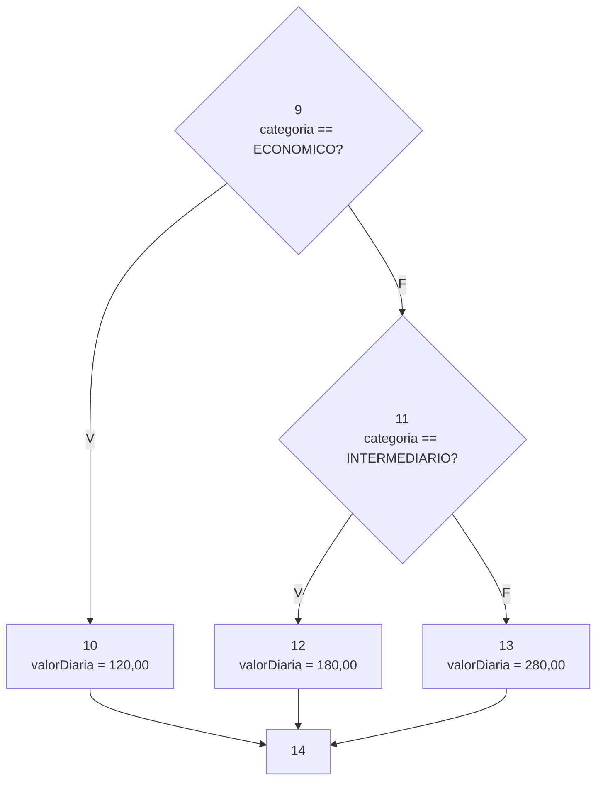
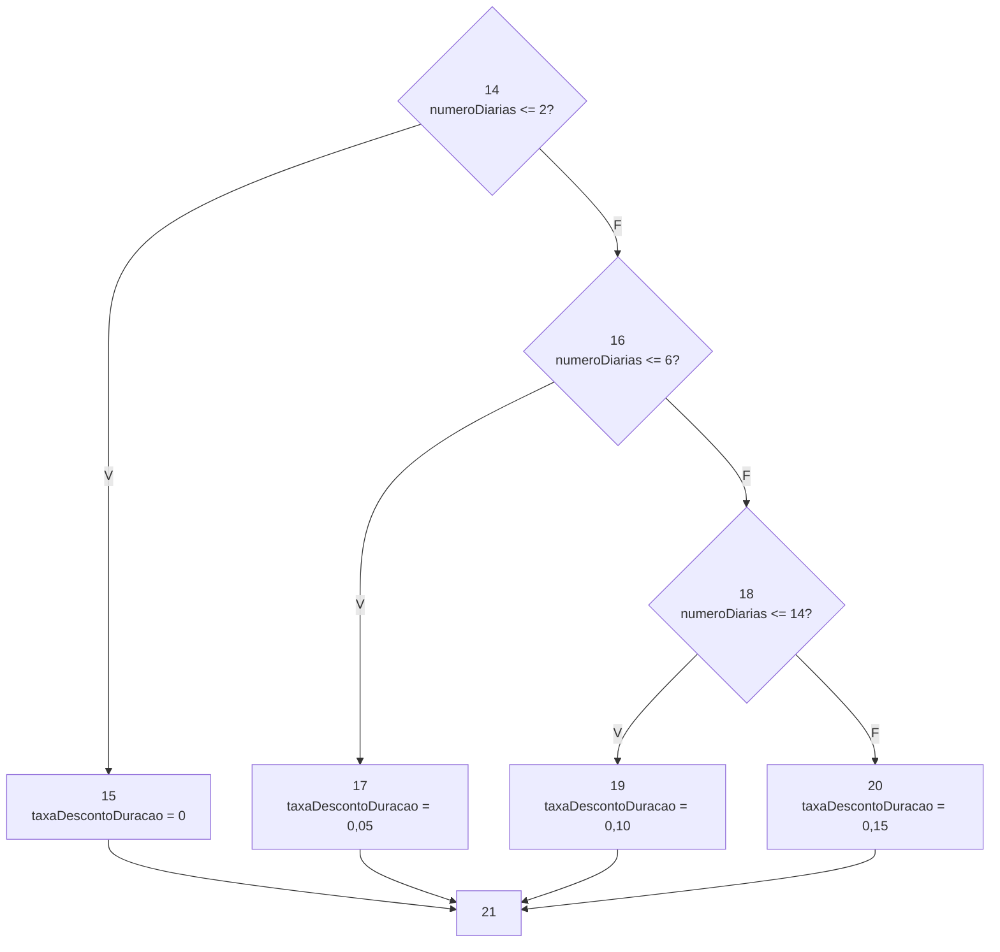
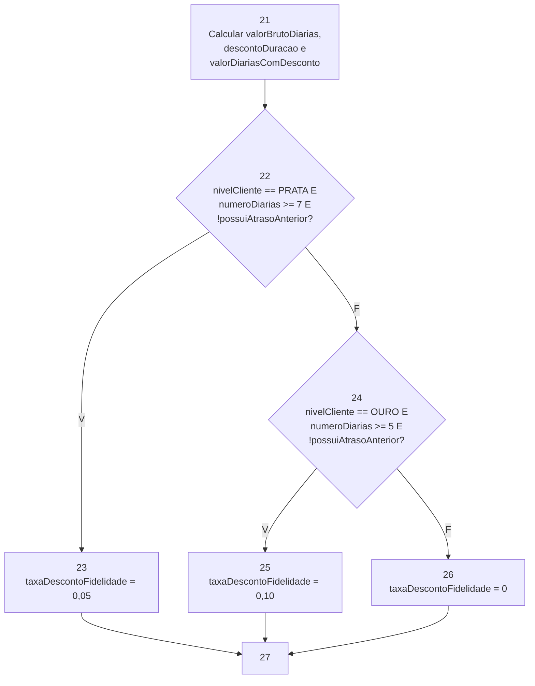
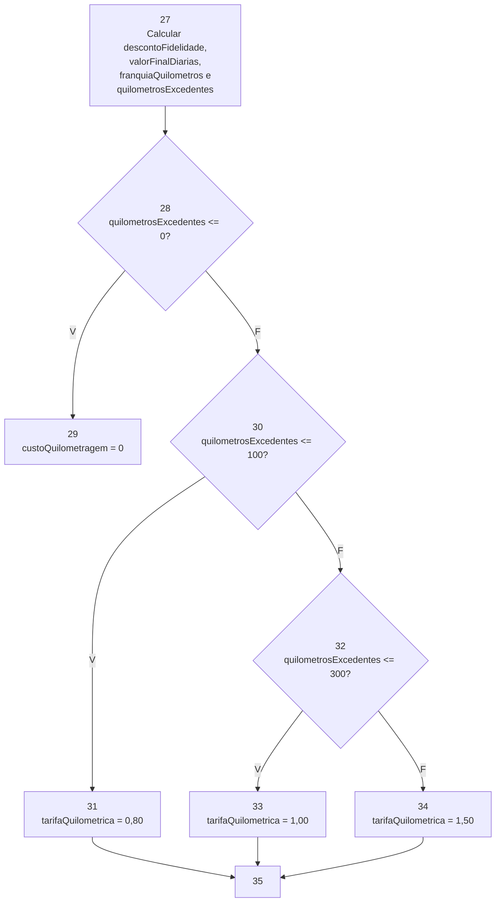
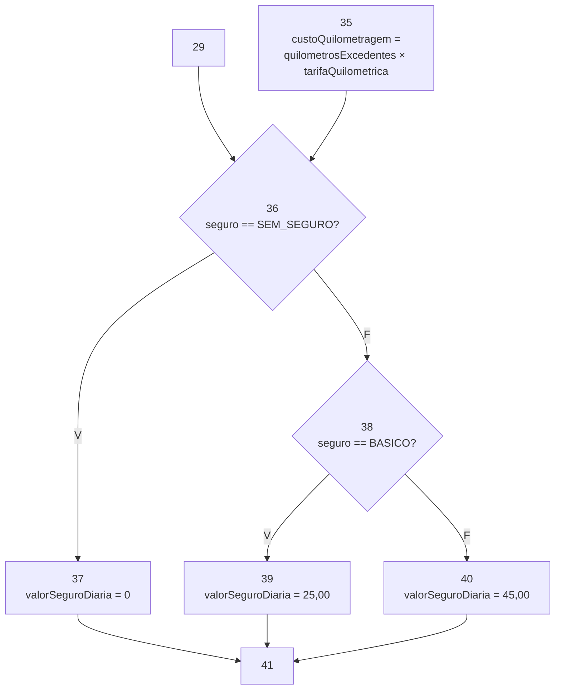
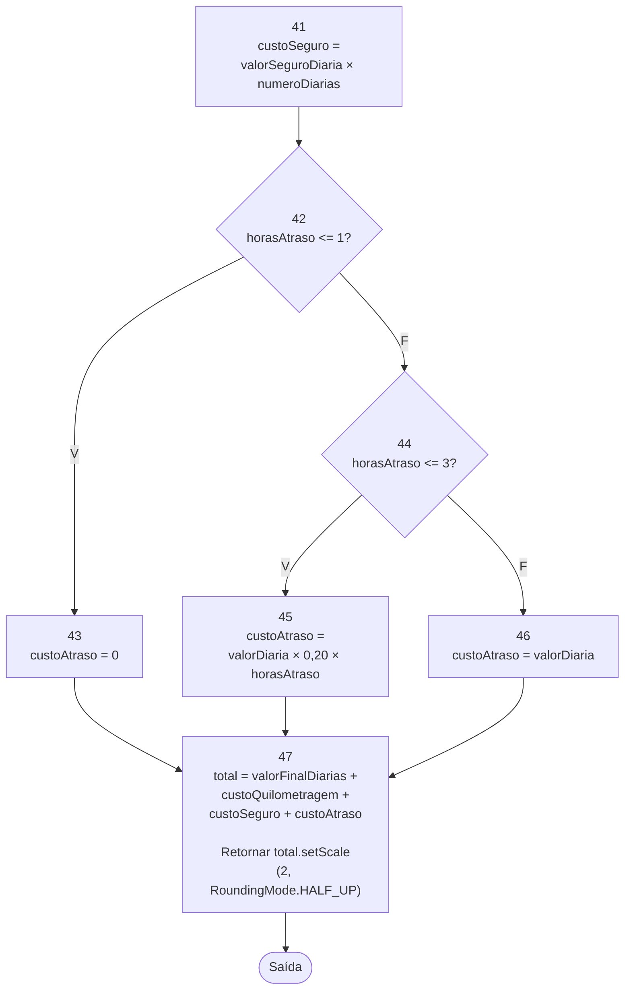

# Respostas — Trabalho Prático da Segunda Unidade

> Preencha os campos indicados e acrescente linhas às tabelas conforme necessário. Mantenha o código dos testes em `src/test/java` e os relatórios originais e logs em `evidencias/`, referenciados por links relativos neste arquivo. Consulte os requisitos completos no [enunciado](ENUNCIADO.md).

## Identificação dos alunos

| Integrante | Nome completo | Matrícula |
|---|---|---|
| Aluno(a) 1 | A preencher | A preencher |
| Aluno(a) 2 (se houver) | A preencher | A preencher |

- Turma: A preencher.
- Data: A preencher.
- `artifactId`: A preencher.

## 5.1. Cobertura de arestas

Classe: `CoberturaArestasTest.java`. Registre os resultados de sua execução isolada.

### Grafo de fluxo de controle

<!-- Insira o grafo e descreva as convenções de entrada, saída, curto-circuito e saídas por exceção. -->

Validação dos argumentos:

\
Valor da diária:

\
Desconto por duração:

\
Desconto por fidelidade:

\
Custo da quilometragem:

\
Custo do seguro:

\
Custo do atraso:

### Identificação dos nós e das arestas

| Nó | Trecho ou linhas do código | Descrição |
|---|---|---|
| A preencher | A preencher | A preencher |

| Aresta | Origem | Destino | Condição ou fluxo |
|---|---|---|---|
| A preencher | A preencher | A preencher | A preencher |

### Casos de teste e rastreabilidade

<!-- Informe todos os argumentos do método em cada caso. Para testes parametrizados, identifique também a invocação correspondente. Explique a obtenção do resultado esperado a partir das regras de negócio. -->

| Caso | Entradas | Resultado ou exceção esperados | Justificativa do resultado esperado | Arestas percorridas | Teste JUnit / invocação |
|---|---|---|---|---|---|
| A preencher | A preencher | A preencher | A preencher | A preencher | A preencher |

### Resultado da cobertura

| Medida | Resultado |
|---|---|
| Total de arestas do grafo | A preencher |
| Arestas percorridas | A preencher |
| Cobertura de arestas (%) | A preencher |
| Ramos cobertos do método no JaCoCo | A preencher |
| Ramos não cobertos do método no JaCoCo | A preencher |
| Cobertura de ramos (%) | A preencher |

Análise da correspondência entre grafo, testes e JaCoCo, incluindo exceções: A preencher.

Evidências HTML, XML e log (links relativos): A preencher.

## 5.2. Critério de McCabe

Classe: `CaminhosBasicosTest.java`. Registre os resultados de sua execução isolada.

### Complexidade ciclomática

| Elemento | Contagem |
|---|---|
| Nós (N) | 55 |
| Arestas (E) | 78 |
| Decisões binárias | 24 |

- Cálculo por `E - N + 2`: 78 - 55 + 2 = 25.
- Cálculo por decisões binárias + 1: 24 + 1 = 25.
- Convenção de saída única e tratamento do curto-circuito:  O grafo possui uma entrada IN e uma saída OUT únicas. As saídas por exceção dos nós B2, B4, B6 e B8 também apontam para OUT. As decisões compostas foram expandidas em condições atômicas: B1a/B1b/B1c representam categoria == null, nivelCliente == null e seguro == null; B22a/B22b/B22c representam nivelCliente == PRATA, numeroDiarias >= 7 e !possuiAtrasoAnterior; B24a/B24b/B24c representam nivelCliente == OURO, numeroDiarias >= 5 e !possuiAtrasoAnterior. Assim, o curto-circuito de || e && aparece como arestas separadas no grafo.
- Comparação com a complexidade do método no JaCoCo e explicação de divergências: o relatório target/site/jacoco/arestas/jacoco.xml informa complexidade 25 para calcularCustoLocacao; o total da classe é 26 porque inclui o construtor implícito. O valor coincide com E - N + 2 = 25 e com 24 + 1 = 25. Se as decisões compostas fossem contadas como um único nó, teríamos 18 decisões e V(G) = 19; a diferença de 6 corresponde exatamente às duas condições adicionais de cada uma das três decisões com curto-circuito (B1, B22 e B24).

### Caminhos independentes e testes

- Ordem das entradas: categoria/nível/diárias/km/horas/seguro/atraso anterior.
- Abreviações: ECO = ECONOMICO, INT = INTERMEDIARIO, COM = COMUM, PRA = PRATA, OUR = OURO, SEM = SEM_SEGURO, BAS = BASICO, CMP = COMPLETO; N = sem atraso anterior, S = com atraso anterior.
- Para economizar espaço na tabela, foram definidos os seguintes trechos comuns:
PREFIXO = IN -> B1a -> B1b -> B1c -> B3 -> B5 -> B7
SUFIXO  = B27 -> B28 -> B29 -> B36 -> B37 -> B41 -> B42 -> B43 -> B47 -> OUT

| Caminho | Sequência de nós ou arestas | Caso / entradas | Resultado esperado | Teste JUnit / invocação |
|---|---|---|---|---|
| P1 | PREFIXO → B9 → B10 → B14 → B15 → B21 → B22a → B24a → B26 → SUFIXO | ECO/COM/1/0/0/SEM/N | 120,00 | deveExecutarCaminhoDeSucesso[P1] |
| P2 | IN → B1a → B2 → OUT | null/COM/1/0/0/SEM/N | NullPointerException | caminhoP2DeveLancarExcecaoQuandoCategoriaForNula|
| P3 |IN → B1a → B1b → B2 → OUT |	ECO/null/1/0/0/SEM/N |	NullPointerException |	caminhoP3DeveLancarExcecaoQuandoNivelClienteForNulo |
|P4 |	IN → B1a → B1b → B1c → B2 → OUT |	ECO/COM/1/0/0/null/N |	NullPointerException |	caminhoP4DeveLancarExcecaoQuandoSeguroForNulo |
|P5 |	IN → B1a → B1b → B1c → B3 → B4 → OUT |	ECO/COM/0/0/0/SEM/N |	IllegalArgumentException |	caminhoP5DeveLancarExcecaoQuandoNumeroDeDiariasForInvalido |
|P6 |	IN → B1a → B1b → B1c → B3 → B5 → B6 → OUT |	ECO/COM/1/-1/0/SEM/N |	IllegalArgumentException |	caminhoP6DeveLancarExcecaoQuandoQuilometragemForNegativa |
|P7 |	IN → B1a → B1b → B1c → B3 → B5 → B7 → B8 → OUT |	ECO/COM/1/0/-1/SEM/N |	IllegalArgumentException |	caminhoP7DeveLancarExcecaoQuandoHorasDeAtrasoForemNegativas |
|P8 |	PREFIXO → B9 → B11 → B12 → B14 → B15 → B21 → B22a → B24a → B26 → SUFIXO |	INT/COM/1/0/0/SEM/N |	180,00 |	deveExecutarCaminhoDeSucesso[P8] |
|P9 |	PREFIXO → B9 → B11 → B13 → B14 → B15 → B21 → B22a → B24a → B26 → SUFIXO |	SUV/COM/1/0/0/SEM/N |	280,00 |	deveExecutarCaminhoDeSucesso[P9] |
|P10 |	PREFIXO → B9 → B10 → B14 → B16 → B17 → B21 → B22a → B24a → B26 → SUFIXO |	ECO/COM/3/0/0/SEM/N |	342,00 |	deveExecutarCaminhoDeSucesso[P10] |
|P11 |	PREFIXO → B9 → B10 → B14 → B16 → B18 → B19 → B21 → B22a → B24a → B26 → SUFIXO |	ECO/COM/7/0/0/SEM/N |	756,00 |	deveExecutarCaminhoDeSucesso[P11] |
|P12 |	PREFIXO → B9 → B10 → B14 → B16 → B18 → B20 → B21 → B22a → B24a → B26 → SUFIXO |	ECO/COM/15/0/0/SEM/N |	1530,00 |	deveExecutarCaminhoDeSucesso[P12] |
|P13 |	PREFIXO → B9 → B10 → B14 → B15 → B21 → B22a → B22b → B22c → B23 → SUFIXO |	ECO/PRA/7/0/0/SEM/N |	718,20 |	deveExecutarCaminhoDeSucesso[P13] |
|P14 |	PREFIXO → B9 → B10 → B14 → B15 → B21 → B22a → B22b → B24a → B26 → SUFIXO	|	ECO/PRA/6/0/0/SEM/N	|	684,00	|	deveExecutarCaminhoDeSucesso[P14] |
|P15 |	PREFIXO → B9 → B10 → B14 → B15 → B21 → B22a → B22b → B22c → B24a → B26 → SUFIXO|	ECO/PRA/7/0/0/SEM/S|	756,00	|deveExecutarCaminhoDeSucesso[P15]|
|P16 |	PREFIXO → B9 → B10 → B14 → B15 → B21 → B22a → B24a → B24b → B24c → B25 → SUFIXO|	ECO/OUR/5/0/0/SEM/N|	513,00	|deveExecutarCaminhoDeSucesso[P16]|
|P17 |	PREFIXO → B9 → B10 → B14 → B15 → B21 → B22a → B24a → B24b → B26 → SUFIXO|	ECO/OUR/4/0/0/SEM/N	456,00|	deveExecutarCaminhoDeSucesso[P17]|
|P18 |	PREFIXO → B9 → B10 → B14 → B15 → B21 → B22a → B24a → B24b → B24c → B26 → SUFIXO|	ECO/OUR/5/0/0/SEM/S|	570,00	|deveExecutarCaminhoDeSucesso[P18]|
|P19 |	PREFIXO → B9 → B10 → B14 → B15 → B21 → B22a → B24a → B26 → B27 → B28 → B30 → B31 → B35 → B36 → B37 → B41 → B42 → B43 → B47 → OUT|	ECO/COM/1/200/0/SEM/N|	200,00	|deveExecutarCaminhoDeSucesso[P19]|
|P20 |	PREFIXO → B9 → B10 → B14 → B15 → B21 → B22a → B24a → B26 → B27 → B28 → B30 → B32 → B33 → B35 → B36 → B37 → B41 → B42 → B43 → B47 → OUT|	ECO/COM/1/400/0/SEM/N|	420,00	|deveExecutarCaminhoDeSucesso[P20]|
|P21 |	PREFIXO → B9 → B10 → B14 → B15 → B21 → B22a → B24a → B26 → B27 → B28 → B30 → B32 → B34 → B35 → B36 → B37 → B41 → B42 → B43 → B47 → OUT|	ECO/COM/1/500/0/SEM/N|	720,00	|deveExecutarCaminhoDeSucesso[P21]|
|P22 |	PREFIXO → B9 → B10 → B14 → B15 → B21 → B22a → B24a → B26 → B27 → B28 → B29 → B36 → B38 → B39 → B41 → B42 → B43 → B47 → OUT|	ECO/COM/1/0/0/BAS/N|	145,00	|deveExecutarCaminhoDeSucesso[P22]|
|P23 |	PREFIXO → B9 → B10 → B14 → B15 → B21 → B22a → B24a → B26 → B27 → B28 → B29 → B36 → B38 → B40 → B41 → B42 → B43 → B47 → OUT|	ECO/COM/1/0/0/CMP/N|	165,00	|deveExecutarCaminhoDeSucesso[P23]|
|P24 |	PREFIXO → B9 → B10 → B14 → B15 → B21 → B22a → B24a → B26 → B27 → B28 → B29 → B36 → B37 → B41 → B42 → B44 → B45 → B47 → OUT|	ECO/COM/1/0/2/SEM/N|	168,00	|deveExecutarCaminhoDeSucesso[P24]|
|P25 |	PREFIXO → B9 → B10 → B14 → B15 → B21 → B22a → B24a → B26 → B27 → B28 → B29 → B36 → B37 → B41 → B42 → B44 → B46 → B47 → OUT|	ECO/COM/1/0/4/SEM/N|	240,00	|deveExecutarCaminhoDeSucesso[P25]|

### Demonstração de independência

Foi utilizada a construção incremental: P1 é o caminho base e cada caminho seguinte introduz pelo menos uma aresta que não aparece em nenhum caminho anterior. A tabela abaixo identifica essas arestas.
<!-- Inclua a matriz caminho × aresta e sua análise ou a demonstração incremental exigida pelo enunciado. -->

| Caminho	| Aresta(s) nova(s) em relação aos caminhos anteriores |
|---|---|
|P1	|Define a base do conjunto|
|P2 |	B1a→B2, B2→OUT|
|P3 |	B1b→B2|
|P4 |	B1c→B2|
|P5 |	B3→B4, B4→OUT|
|P6 |	B5→B6, B6→OUT|
|P7 |	B7→B8, B8→OUT|
|P8 |	B9→B11, B11→B12, B12→B14|
|P9 |	B11→B13, B13→B14|
|P10|	B14→B16, B16→B17, B17→B21|
|P11|	B16→B18, B18→B19, B19→B21|
|P12|	B18→B20, B20→B21|
|P13|	B22a→B22b, B22b→B22c, B22c→B23, B23→B27|
|P14|	B22b→B24a|
|P15|	B22c→B24a|
|P16|	B24a→B24b, B24b→B24c, B24c→B25, B25→B27|
|P17|	B24b→B26|
|P18|	B24c→B26|
|P19|	B28→B30, B30→B31, B31→B35, B35→B36|
|P20|	B30→B32, B32→B33, B33→B35|
|P21|	B32→B34, B34→B35|
|P22|	B36→B38, B38→B39, B39→B41|
|P23|	B38→B40, B40→B41|
|P24|	B42→B44, B44→B45, B45→B47|
|P25|	B44→B46, B46→B47|

Como cada caminho a partir de P2 acrescenta pelo menos uma aresta nova, os 25 caminhos são linearmente independentes. O conjunto percorre as 78 arestas do grafo.

### Caminhos inviáveis e limitações

<!-- Quando houver, apresente as restrições contraditórias, as alternativas buscadas e a justificativa para o tamanho do conjunto viável obtido. Caso não haja, registre isso após a análise. -->
Não há caminhos inviáveis. As 24 decisões atômicas são alcançáveis e os 25 caminhos escolhidos são executáveis. As dependências impostas pelo curto-circuito foram consideradas na 
construção:por exemplo, quando nivelCliente != PRATA, as condições numeroDiarias >= 7 e !possuiAtrasoAnterior da decisão PRATA não são avaliadas, mas o caminho que segue para 
a decisão OURO é viável e independente.

#### Resultado da execução

|Medida	|Resultado|
|---|---|
|Testes executados|	25|
|Falhas|	0|
|Erros|	0|
|Ignorados|	0|
|Ramos cobertos no JaCoCo|	48 de 48|
|Linhas cobertas no JaCoCo|	53 de 53|
|Complexidade do método no JaCoCo|	25|

Evidências:
- evidencias/surefire/caminhos/br.com.aluguelcarros.CaminhosBasicosTest.txt
- evidencias/jacoco/caminhos/index.html
- evidencias/jacoco/caminhos/jacoco.xml
- evidencias/logs/caminhos.log

## 5.3. MC/DC em duas decisões

Classe: `McdcTest.java`. Registre os resultados de sua execução isolada.

### Decisão 1

- Expressão e localização no código: A preencher.
- Condição A: A preencher.
- Condição B: A preencher.
- Condição C: A preencher.

| Caso / entradas | A (valor lógico) | B (valor lógico) | C (valor lógico) | Condições efetivamente avaliadas | Resultado da decisão | Resultado esperado do método | Teste JUnit / invocação |
|---|---|---|---|---|---|---|---|
| A preencher | A preencher | A preencher | A preencher | A preencher | A preencher | A preencher | A preencher |

| Condição | Par de casos | Demonstração da influência independente |
|---|---|---|
| A | A preencher | A preencher |
| B | A preencher | A preencher |
| C | A preencher | A preencher |

Justificativa de alcance da decisão, curto-circuito e atendimento ao MC/DC de causa única: A preencher.

### Decisão 2

- Expressão e localização no código: A preencher.
- Condição A: A preencher.
- Condição B: A preencher.
- Condição C: A preencher.

| Caso / entradas | A (valor lógico) | B (valor lógico) | C (valor lógico) | Condições efetivamente avaliadas | Resultado da decisão | Resultado esperado do método | Teste JUnit / invocação |
|---|---|---|---|---|---|---|---|
| A preencher | A preencher | A preencher | A preencher | A preencher | A preencher | A preencher | A preencher |

| Condição | Par de casos | Demonstração da influência independente |
|---|---|---|
| A | A preencher | A preencher |
| B | A preencher | A preencher |
| C | A preencher | A preencher |

Justificativa de alcance da decisão, curto-circuito e atendimento ao MC/DC de causa única: A preencher.

## 5.4. Teste de mutação com PIT

Escopo: suíte completa das três classes de teste.

### Configuração e resultados

- Escopo e operadores utilizados: A preencher.
- Comando executado e resultado da execução Maven: A preencher.
- Total de mutantes: A preencher.
- Percentual de mutantes com status `KILLED`: A preencher.

| Status no PIT | Quantidade |
|---|---|
| A preencher | A preencher |

Testes acrescentados ou aprimorados após a análise: A preencher.

Evidências HTML, XML e log (links relativos): A preencher.

### Análise individual de mutantes não mortos

<!-- Repita os campos abaixo para cada mutante não morto. Se todos foram mortos, registre esse resultado e a evidência correspondente. -->

- Identificação, linha e operador: A preencher.
- Alteração realizada pelo mutante: A preencher.
- Status no PIT: A preencher.
- Tentativas de teste e resultados: A preencher.
- Justificativa técnica da impossibilidade, quando aplicável: A preencher.
- Demonstração de equivalência para todo o domínio previsto, quando alegada: A preencher.
- Eventual flexibilização do bloqueio Maven e justificativa: A preencher.

## 5.5. Test smells com tsDetect

Escopo: suíte completa das três classes de teste.

### Configuração e abrangência

- Versão/commit e adaptações utilizadas: A preencher.
- Comando executado, requisitos e limiares: A preencher.
- Quantidade e identificação dos arquivos e métodos esperados: A preencher.
- Quantidade e identificação dos arquivos e métodos analisados: A preencher.
- Conferência de reconhecimento dos recursos JUnit utilizados: A preencher.

### Ocorrências e refatorações

<!-- Registre todos os tipos de smell analisados, inclusive aqueles com zero ocorrências. -->

| Tipo de smell | Ocorrências iniciais | Refatoração realizada, se necessária | Ocorrências finais |
|---|---|---|---|
| A preencher | A preencher | A preencher | A preencher |

Verificação de preservação das asserções, cobertura, caminhos de McCabe, MC/DC e resultado de mutação após as refatorações: A preencher.

Evidências do relatório original, resumo de abrangência e logs (links relativos): A preencher.

## 5.6. Automação e relatório consolidado

### Ambiente e versões

| Componente | Versão utilizada |
|---|---|
| Java | A preencher |
| Maven | A preencher |
| JUnit | A preencher |
| JaCoCo | A preencher |
| PIT e plugin JUnit 5 | A preencher |
| tsDetect e adaptação | A preencher |
| Python e Git | A preencher |

### Execuções finais

<!-- Registre os comandos efetivamente executados na versão final da entrega. -->

| Análise | Comando e perfil | Data da execução | Resultado Maven | Relatório / log (link relativo) |
|---|---|---|---|---|
| JUnit | A preencher | A preencher | A preencher | A preencher |
| JaCoCo / arestas isoladas | A preencher | A preencher | A preencher | A preencher |
| JaCoCo / caminhos isolados | A preencher | A preencher | A preencher | A preencher |
| JaCoCo / MC/DC isolado | A preencher | A preencher | A preencher | A preencher |
| PIT | A preencher | A preencher | A preencher | A preencher |
| tsDetect | A preencher | A preencher | A preencher | A preencher |

- Testes executados: A preencher.
- Falhas: A preencher.
- Erros: A preencher.
- Testes ignorados: A preencher.
- Alterações na automação ou opções de execução, se houver: A preencher.
- Identificação da versão final analisada (commit, se disponível): A preencher.

### Conclusão por requisito

| Requisito | Resultado alcançado | Evidência / seção | Limitações ou justificativas |
|---|---|---|---|
| 100% de cobertura de arestas | A preencher | A preencher | A preencher |
| Caminhos básicos de McCabe | A preencher | A preencher | A preencher |
| MC/DC nas duas decisões | A preencher | A preencher | A preencher |
| Todos os mutantes mortos ou impossibilidades justificadas | A preencher | A preencher | A preencher |
| Zero ocorrências no tsDetect | A preencher | A preencher | A preencher |
| Execução reproduzível pelo Maven | A preencher | A preencher | A preencher |

## 6. Conferência da entrega

- [ ] Integrantes e `artifactId` identificados.
- [ ] Todas as respostas preenchidas neste arquivo.
- [ ] Código de produção fornecido preservado.
- [ ] Código dos testes nas três classes exigidas em `src/test/java`, com cada critério demonstrado isoladamente.
- [ ] Instruções do README conferidas e atualizadas, se necessário.
- [ ] Relatórios e logs da versão final copiados para `evidencias/` e referenciados neste arquivo.
- [ ] Recursos necessários à abertura dos relatórios HTML preservados.
- [ ] Projeto compactado no formato e com o nome exigidos, sem `target`.
